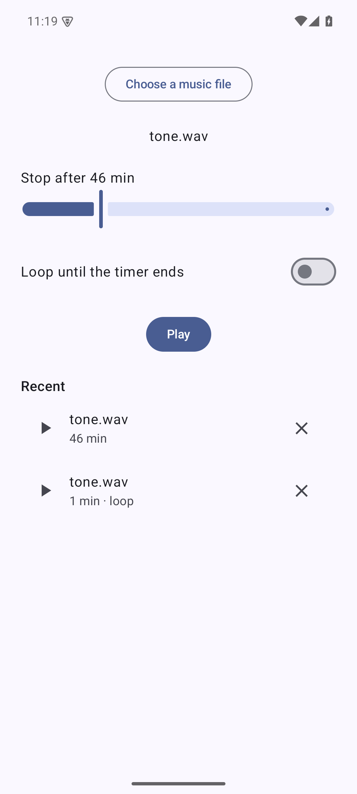
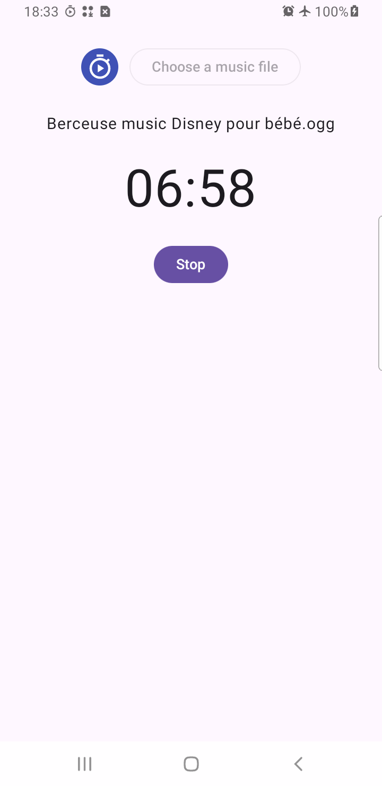
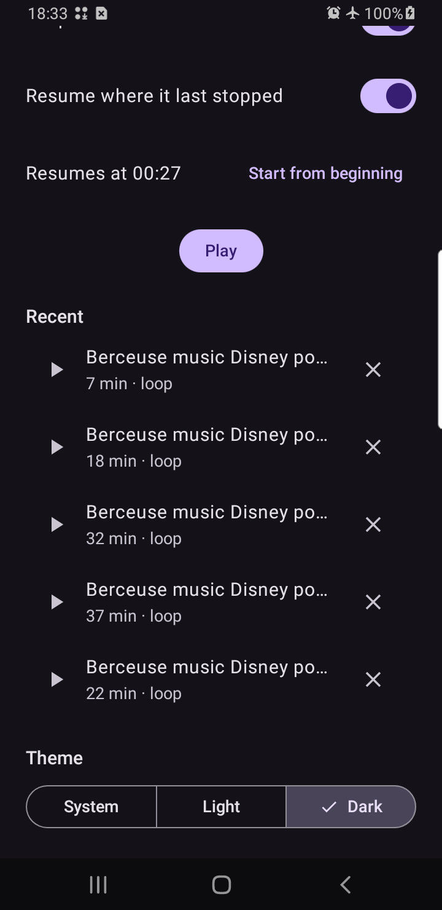

  

<h1 align="center">ChronoPlay</h1>

Small Android app: pick a local music file, choose a duration, press Play —
playback stops automatically when the timer runs out.

  
  &nbsp;
  
  &nbsp;
  

## Features

- **Precise duration**: hours and minutes scroll wheels, from 1 min up to
  23 h 59.
- **Fade-out**: the volume fades down over the last 5 seconds instead of
  cutting off.
- **Loop** (optional): a short track keeps playing until the timer ends.
- **Resume** (optional): each file remembers where it stopped (timer end,
  Stop button, or another app taking the audio) and the next play continues
  from there. *Start from beginning* clears it; a file that played to its end
  starts over.
- **Recent**: the last 5 file + duration + loop combinations; tap one to start
  it again instantly, or ✕ to remove it.
- **Theme**: System, Light or Dark, chosen at the bottom of the screen.
- **Keeps playing with the screen off**: playback runs in a foreground service
  (`PlaybackService`); the notification shows a live countdown and a Stop action.
- Pauses during phone calls and lowers the volume for other apps' short
  sounds, while the timer keeps running.

Kotlin + Jetpack Compose (Material 3), minSdk 26, targetSdk 35.

## Build

Open the folder in Android Studio, or from a terminal with the Android SDK installed:

    ./gradlew assembleDebug
    ./gradlew installDebug

Gradle 8.13 needs JDK 17 or 21 (Android Studio ships one). `gradle.properties`
points Gradle at `/usr/lib/jvm/java-21-openjdk-amd64` (`org.gradle.java.home`),
because a newer default `java` such as 25 makes the build fail with only its
version number as the error. On a machine where JDK 21 lives elsewhere, change
that line or remove it and set `JAVA_HOME`.

## Deploy on a real device

### 1. Prepare the phone (once)

1. Open **Settings → About phone** and tap **Build number** seven times to
   unlock **Developer options**.
2. In **Settings → System → Developer options**, turn on **USB debugging**.
   (The exact menu path varies a little between manufacturers.)

### 2. Connect it

**Over USB:** plug the phone in, then accept the *Allow USB debugging?* prompt
on the phone (tick *Always allow from this computer*).

**Over Wi-Fi (Android 11+, same network as the computer):** in Developer
options open **Wireless debugging → Pair device with pairing code**, then:

    adb pair <ip>:<pairing-port>      # enter the 6-digit code shown on the phone
    adb connect <ip>:<port>           # the port shown on the Wireless debugging screen

Check that the device is listed as `device` (not `unauthorized`):

    adb devices

`adb` is in `~/Android/Sdk/platform-tools/`; add that folder to your `PATH`
or call it with the full path.

### 3. Install and run

From Android Studio: select the phone in the device drop-down and press **Run**.

From a terminal:

    ./gradlew installDebug
    adb shell am start -n com.example.chronoplay/.MainActivity

If several devices are connected, pick one with `adb -s <serial> …` or
`ANDROID_SERIAL=<serial> ./gradlew installDebug`.

### Without a cable: sideload the APK

Build `./gradlew assembleDebug`, copy
`app/build/outputs/apk/debug/app-debug.apk` to the phone (USB transfer, cloud
drive, e-mail…), open it, and allow *Install unknown apps* for the app you
opened it from when Android asks.

### Troubleshooting

- **Device shows `unauthorized`**: unlock the phone and accept the debugging
  prompt; if it never appears, use *Revoke USB debugging authorizations* in
  Developer options and reconnect.
- **Device not listed on Linux over USB**: switch the USB mode to *File
  transfer*, and make sure udev rules allow access (e.g. install the
  `android-sdk-platform-tools-common` package on Debian/Ubuntu/Mint).
- **`INSTALL_FAILED_UPDATE_INCOMPATIBLE`**: an APK signed with another key is
  already installed; remove it with `adb uninstall com.example.chronoplay`.
- **No countdown notification**: allow notifications for ChronoPlay in the
  app's system settings. Playback works either way.

## License

[MIT](LICENSE)
